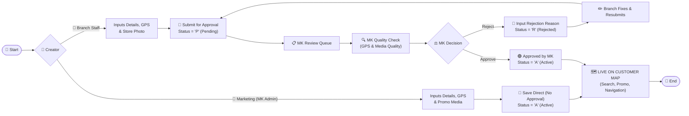
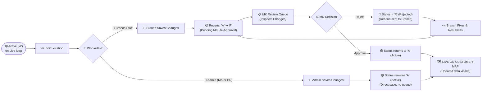
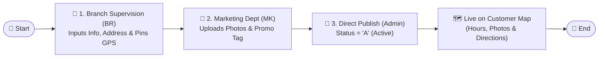

# Service Point: Roles & Approval Workflow by Location Type
> **Specific Departmental Governance for Merchant and Branch Locations**
> *(Note: ATM flow is currently pending confirmation and is excluded from this document)*

---

## 📌 Executive Summary & Scope

The Service Point management system separates workflows by **Location Type**, assigning distinct administrative authorities to specialized departments:

| Location Type | Primary Admin Departments | Creator Roles | Approval Required? |
| :--- | :--- | :--- | :--- |
| 🏪 **Merchant (ຮ້ານຄ້າ)** | **Marketing Department (MK)** | • MK Department (Admin)<br>• Branch Staff (Maker) | • **MK creates:** ❌ No (Status `A` Direct)<br>• **Branch creates:** ✅ Yes (Status `P` ➔ MK Approves) |
| 🏦 **Branch (ສາຂາ)** | **Branch Supervision (BR)** & **Marketing (MK)** | • BR Department (Data Admin)<br>• MK Department (Media Admin) | ❌ Both are Admin departments; collaborate on Data + Images |
| 🏧 **ATM (ຕູ້ ATM)** | *Pending confirmation* | *Excluded for now* | *TBD* |

---

## 🏪 FLOW 1: Merchant Locations (ຮ້ານຄ້າພັນທະມິດ)

For Merchant locations, **Marketing Department (MK)** is the ultimate authority (Admin).

### 1. Department Roles
* **Marketing Department (MK) — [Admin]:**
  * Direct publication authority.
  * When MK creates/posts a Merchant, it is saved directly as **Active (`A`)** with **NO approval needed**.
  * Reviews and acts as the gatekeeper for Merchant records submitted by branches.
* **Branch Department / Branch Staff — [Maker]:**
  * When a branch acquires a new local merchant partner, they submit the initial details and location.
  * Saved as **Pending (`P`)**. Must be approved by MK before appearing on the public map.

### 2. Merchant Approval Matrix
| Action | Branch Staff (Maker) | Marketing Dept (MK - Admin) | Resulting Status & Effect |
| :--- | :---: | :---: | :--- |
| **MK creates Merchant** | — | ✅ **Yes** | **`A` (Active)** — Live on public map immediately |
| **Branch creates Merchant** | ✅ **Yes** | — | **`P` (Pending)** — Awaiting MK review |
| **MK approves Branch submission** | ❌ No | ✅ **Yes** | **`A` (Active)** — Published to public map |
| **MK rejects Branch submission** | ❌ No | ✅ **Yes** | **`R` (Rejected)** — Sent back to Branch with reason |
| **Branch updates rejected record** | ✅ **Yes** | — | Resubmitted as **`P` (Pending)** |

### 3. Merchant Creation & Initial Approval Flowchart (Horizontal)



---

## 🔄 FLOW 2: Edit Lifecycle (When Status Changes from 'A' to 'P')

When an existing location that is already **Active (`A`)** on the live map gets updated, the system enforces quality and brand protection rules:

### 1. Why does status revert from `A` to `P`?
* **Data & Brand Integrity:** To prevent unverified details (e.g., incorrect phone numbers, moved GPS pins, or unauthorized discount claims) from showing up immediately on customer mobile apps.
* **Dual Control:** Any modifications submitted by **Branch Staff** must be re-verified by **Marketing (MK)**.

### 2. Edit Rules by Role
* **If Branch Staff edits an Active (`A`) Merchant:**
  * ⚠️ **Status reverts from `A` (Active) ➔ `P` (Pending Re-Approval).**
  * The location is temporarily paused/hidden from the public map until re-verified.
  * The record re-enters the **Marketing Department (MK) Review Queue**.
  * **MK Decision:**
    * **Approve:** Status returns to **`A` (Active)** with the newly updated information live on the map.
    * **Reject:** Status becomes **`R` (Rejected)** with comments explaining why the edits were refused.
* **If Marketing Department (MK - Admin) edits an Active (`A`) Merchant:**
  * ✅ **Direct Update:** Status remains **`A` (Active)**. No approval needed. Changes appear instantly on the map.
* **If Branch Supervision (BR) or MK edits an Active (`A`) Branch:**
  * ✅ **Direct Update:** Both departments possess Admin authority; modifications remain **`A` (Active)** directly.

### 3. Edit & Re-Approval Flowchart (`A` ➔ `P` ➔ `A` / `R`) (Horizontal)



---

## 🏦 FLOW 3: Branch Locations (ສາຂາ & ໜ່ວຍບໍລິການ)

For bank branches, management is shared between two specialized Admin departments:
1. **Branch Supervision Department (BR / ພະແນກຄຸ້ມຄອງສາຂາ):** Manages official **Data & Operations**.
2. **Marketing Department (MK / ພະແນກການຕະຫຼາດ):** Manages **Visual Media & Promotions**.

### 1. Department Responsibilities Split

```
                         🏦 Branch Location Setup
                                    │
         ┌──────────────────────────┴──────────────────────────┐
         ▼                                                     ▼
 📋 Branch Supervision (BR)                           🎨 Marketing Dept (MK)
   [Data & Operational Admin]                             [Media & Promo Admin]
   • Official Branch Name (Lao/EN)                       • Storefront & Building Photos
   • Province, District, Village                         • Interior & Service Counter Photos
   • Exact GPS Coordinates (Lat/Long)                    • Marketing Campaign Tags (e.g. Hot Deal)
   • Contact Telephone Numbers                           • Promotional Event Dates & Details
   • Official Opening & Closing Hours
```

### 2. Branch Collaboration Workflow
* **Both BR and MK have Admin rights** for Branch locations:
  * **No "Maker-Checker" wait queue** between external staff; both departments work as administrative partners.
  * **BR** inputs or updates the verified operational data and physical GPS coordinates.
  * **MK** uploads polished, brand-compliant photography and attaches seasonal marketing promotions.
  * Status is maintained as **Active (`A`)** upon completion, ensuring customers always see accurate, high-quality branch profiles.

### 3. Branch Workflow Diagram (Horizontal & Easy to Read)



---

## 📊 Summary Comparison: Merchant vs. Branch

| Attribute | 🏪 Merchant (ຮ້ານຄ້າ) | 🏦 Branch (ສາຂາ) |
| :--- | :--- | :--- |
| **Admin Authority** | **Marketing Department (MK)** | **Branch Supervision (BR)** & **Marketing (MK)** |
| **Can Branch Staff Create?** | ✅ Yes (Submits as `P` Pending) | ❌ Managed centrally by BR & MK Admins |
| **Can Branch Staff Edit?** | ✅ Yes (Status changes **`A` ➔ `P`**) | ❌ Managed centrally by BR & MK Admins |
| **Approval on Edit?** | • **If MK edits:** ❌ No (Stays `A`)<br>• **If Branch edits:** ✅ Yes (**`A` ➔ `P` ➔ MK Approves**) | ❌ No (Direct Admin management) |
| **Data Responsibility** | Branch submits initial; MK verifies | **BR:** Address, GPS pin, phone, opening hours |
| **Image Responsibility** | Branch/MK upload storefront photo | **MK:** Professional building & promotional media |
| **Initial Creation Flow** | `P` (Pending) ➔ `A` (Approved) | Direct `A` (Active) upon completion |

---

## 🛠️ Quick SOP by Department

### 📢 Marketing Department (MK)
1. **For Merchants (Initial & Edits):**
   * Create partner merchants directly with instant status **`A`**.
   * Edit existing merchants directly (status stays **`A`**).
   * Open **Service Points** > filter by `Pending` to review branch submissions and edits:
     * Review changes made by the branch (GPS coordinates, phone, images).
     * Click **Approve** to publish/restore to mobile app.
     * Click **Reject** and provide clear feedback if changes are unacceptable.
2. **For Branches:**
   * Review branch entries created by **BR**.
   * Upload approved, high-resolution building photography and promotional banners.

### 🏢 Branch Supervision Department (BR)
1. **For Branches:**
   * Create and maintain all official branch records.
   * Ensure GPS pins match physical building coordinates accurately.
   * Keep opening/closing hours and phone numbers up to date.

### 🏪 Branch Staff
1. **For Merchants:**
   * Enter newly acquired local merchant details, pin their GPS, upload a storefront picture, and submit (`P`).
   * When editing an existing Active (`A`) merchant, be aware that **status will change back to `P` (Pending)** and will require Marketing approval again.
   * If rejected (`R`), check MK feedback, correct the data, and resubmit.
