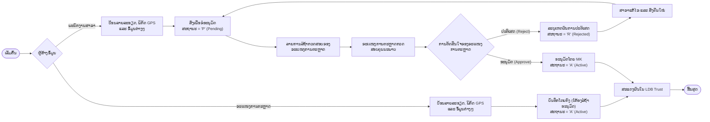
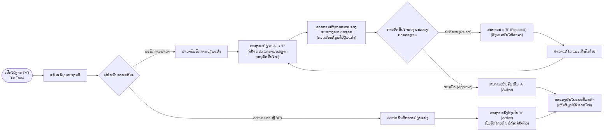
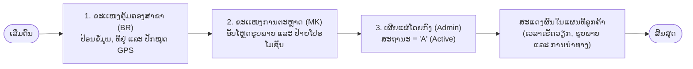

# ຈຸດບໍລິການ (Service Point): ພາລະບົດບາດ ແລະ ຂັ້ນຕອນການອະນຸມັດຕາມປະເພດສະຖານທີ່

**ການກຳນົດສິດຄຸ້ມຄອງສະເພາະຂອງແຕ່ລະຂະເເໜງ ສຳລັບຮ້ານຄ້າ ແລະ ສາຂາ**

_(ໝາຍເຫດ: ຂັ້ນຕອນສຳລັບຕູ້ ATM ແມ່ນກຳລັງລໍຖ້າການຢືນຢັນ ແລະ ຍັງບໍ່ທັນໄດ້ລວມເຂົ້າໃນເອກະສານສະບັບນີ້)_

## ບົດສະຫຼຸບຜູ້ບໍລິຫານ ແລະ ຂອບເຂດວຽກງານ

ລະບົບການຄຸ້ມຄອງຈຸດບໍລິການ (Service Point) ໄດ້ແບ່ງຂັ້ນຕອນການເຮັດວຽກຕາມ **ປະເພດສະຖານທີ່**, ໂດຍມີການມອບໝາຍສິດຄຸ້ມຄອງບໍລິຫານໃຫ້ແກ່ຂະເເໜງວິຊາສະເພາະ ດັ່ງລຸ່ມນີ້:

| ປະເພດສະຖານທີ່          | ຂະເເໜງຄຸ້ມຄອງຫຼັກ (Admin)                               | ພາລະບົດບາດຜູ້ສ້າງຂໍ້ມູນ (Creator)                                  | ຄວາມຈຳເປັນໃນການອະນຸມັດ                                                                                  |
| ---------------------- | ------------------------------------------------------- | ------------------------------------------------------------------ | ------------------------------------------------------------------------------------------------------- |
| **ຮ້ານຄ້າ (Merchant)** | **ຂະເເໜງການຕະຫຼາດ (MK)**                                | \- ຂະເເໜງ MK (Admin) \- ພະນັກງານສາຂາ (Maker)                       | \- **ຂະເເໜງ MK ສ້າງ:** ບໍ່ຈຳເປັນ (ສະຖານະ `A` ໂດຍກົງ) \- **ສາຂາສ້າງ:** ຈຳເປັນ (ສະຖານະ `P` -> MK ອະນຸມັດ) |
| **ສາຂາ (Branch)**      | **ຂະເເໜງຄຸ້ມຄອງສາຂາ (BR)** ແລະ **ຂະເເໜງການຕະຫຼາດ (MK)** | \- ຂະເເໜງ BR (ຜູ້ຄຸ້ມຄອງສາຂາ) \- ຂະເເໜງ MK (ນັກການຕະຫຼາດ) | ບໍ່ຈຳເປັນ (ທັງສອງຂະເເໜງມີສິດ Admin ຮ່ວມກັນໃນການຈັດການຂໍ້ມູນ ແລະ ຮູບພາບ)                                 |
| **ຕູ້ ATM (ATM)**      | _ລໍຖ້າການຢືນຢັນ_                                        | _ຍັງບໍ່ລວມໃນເອກະສານນີ້_                                            | _ລໍຖ້າການກຳນົດ_                                                                                         |

## ຂັ້ນຕອນທີ 1: ສະຖານທີ່ຮ້ານຄ້າ (Merchant Locations)

ສຳລັບສະຖານທີ່ປະເພດຮ້ານຄ້າ, **ຂະເເໜງການຕະຫຼາດ (MK)** ເປັນຜູ້ມີສິດອະນຸມັດສູງສຸດ (Admin).

### 1. ພາລະບົດບາດຂອງຂະເເໜງ

- **ຂະເເໜງການຕະຫຼາດ (MK) — \[ຜູ້ຄຸ້ມຄອງລະບົບ / Admin\]:**
  - ມີສິດໃນການເຜີຍແຜ່ຂໍ້ມູນໂດຍກົງ.

  - ເມື່ອຂະເເໜງການຕະຫຼາດ ສ້າງ ຫຼື ລົງຂໍ້ມູນຮ້ານຄ້າ, ລະບົບຈະບັນທຶກເປັນສະຖານະ **ເປີດໃຊ້ງານ (`A` - Active)** ໂດຍກົງ **ໂດຍບໍ່ຕ້ອງຜ່ານການອະນຸມັດ**.

  - ເຮັດໜ້າທີ່ກວດກາ ແລະ ອະນຸມັດຂໍ້ມູນຮ້ານຄ້າທີ່ຖືກສົ່ງເຂົ້າມາຈາກທາງສາຂາ.

- **ຂະເເໜງຄຸ້ມຄອງສາຂາ / ພະນັກງານສາຂາ — \[ຜູ້ສ້າງຂໍ້ມູນ / Maker\]:**
  - ເມື່ອສາຂາຫາຮ້ານຄ້າໃໝ່ໃນພື້ນທີ່ໄດ້, ພະນັກງານສາຂາຈະເປັນຜູ້ປ້ອນລາຍລະອຽດເບື້ອງຕົ້ນ ແລະ ຕຳແໜ່ງທີ່ຕັ້ງ.

  - ຂໍ້ມູນຈະຖືກບັນທຶກເປັນສະຖານະ **ລໍຖ້າການອະນຸມັດ (`P` - Pending)** ແລະ ຕ້ອງໄດ້ຮັບການອະນຸມັດຈາກຂະເເໜງ MK ກ່ອນ ຈຶ່ງຈະສະແດງຜົນຢູ່ໃນແຜນທີ່ສາທາລະນະ.

### 2. ຕາຕະລາງສິດການອະນຸມັດຂໍ້ມູນຮ້ານຄ້າ

| ກິດຈະກຳການດຳເນີນງານ                | ພະນັກງານສາຂາ (Maker) | ຂະເເໜງການຕະຫຼາດ (MK - Admin) | ສະຖານະຜົນລັບ ແລະ ຜົນກະທົບ                            |
| ---------------------------------- | -------------------- | ---------------------------- | ---------------------------------------------------- |
| **ຂະເເໜງການຕະຫຼາດ ສ້າງຂໍ້ມູນຮ້ານຄ້າ**    | —                    | ມີສິດ                        | **`A` (Active)** — ສະແດງຜົນໃນແຜນທີ່ສາທາລະນະທັນທີ     |
| **ສາຂາສ້າງຂໍ້ມູນຮ້ານຄ້າ**          | ມີສິດ                | —                            | **`P` (Pending)** — ລໍຖ້າການກວດສອບຈາກຂະເເໜງ MK       |
| **ຂະເເໜງການຕະຫຼາດ ອະນຸມັດຂໍ້ມູນຈາກສາຂາ** | ບໍ່ມີສິດ             | ມີສິດ                        | **`A` (Active)** — ເຜີຍແຜ່ລົງໃນແຜນທີ່ສາທາລະນະ        |
| **ຂະເເໜງການຕະຫຼາດ ປະຕິເສດຂໍ້ມູນຈາກສາຂາ** | ບໍ່ມີສິດ             | ມີສິດ                        | **`R` (Rejected)** — ສົ່ງກັບຄືນໃຫ້ສາຂາພ້ອມລະບຸເຫດຜົນ |
| **ສາຂາແກ້ໄຂຂໍ້ມູນທີ່ຖືກປະຕິເສດ**   | ມີສິດ                | —                            | ສົ່ງເຂົ້າລະບົບຄືນໃໝ່ໃນສະຖານະ **`P` (Pending)**       |

### 3. ແຜນວາດຂັ້ນຕອນການສ້າງ ແລະ ການອະນຸມັດຂໍ້ມູນຮ້ານຄ້າເບື້ອງຕົ້ນ

## ຂັ້ນຕອນທີ 2: ການແກ້ໄຂຂໍ້ມູນ (ກໍລະນີສະຖານະປ່ຽນຈາກ 'A' ເປັນ 'P')

ເມື່ອສະຖານທີ່ທີ່ມີສະຖານະ **ເປີດໃຊ້ງານ (`A` - Active)** ຢູ່ໃນ LDB Trust ມີການປັບປຸງແກ້ໄຂຂໍ້ມູນ, ລະບົບຈະບັງຄັບໃຊ້ກົດລະບຽບເພື່ອຮັບປະກັນຄຸນນະພາບ ແລະ ປົກປ້ອງພາບລັກຂອງອົງກອນ ດັ່ງນີ້:

### 1. ເຫດຜົນທີ່ສະຖານະຕ້ອງປ່ຽນຈາກ `A` ກັບຄືນເປັນ `P`

- **ຄວາມຖືກຕ້ອງຂອງຂໍ້ມູນ ແລະ ພາບລັກອົງກອນ:** ເພື່ອປ້ອງກັນບໍ່ໃຫ້ຂໍ້ມູນທີ່ຍັງບໍ່ທັນຜ່ານການກວດສອບ (ເຊັ່ນ: ເບີໂທລະສັບບໍ່ຖືກຕ້ອງ, ການຍ້າຍຈຸດພິກັດ GPS ຜິດພາດ, ຫຼື ການລະບຸສ່ວນຫຼຸດທີ່ບໍ່ໄດ້ຮັບອະນຸຍາດ) ສະແດງຜົນຂຶ້ນທັນທີໃນແອັບພລິເຄຊັນຂອງລູກຄ້າ.

- **ການຄວບຄຸມສອງຊັ້ນ (Dual Control):** ທຸກການແກ້ໄຂຂໍ້ມູນທີ່ດຳເນີນການໂດຍ **ພະນັກງານສາຂາ** ຈະຕ້ອງຜ່ານການກວດສອບຄືນໃໝ່ໂດຍ **ຂະເເໜງການຕະຫຼາດ** ສະເໝີ.

### 2. ກົດລະບຽບການແກ້ໄຂຂໍ້ມູນຕາມພາລະບົດບາດ

- **ກໍລະນີພະນັກງານສາຂາ ແກ້ໄຂຂໍ້ມູນຮ້ານຄ້າທີ່ເປີດໃຊ້ງານຢູ່ (`A`):**
  - **ສະຖານະຈະປ່ຽນຈາກ `A` (Active) ກັບຄືນເປັນ `P` (Pending Re-Approval).**

  - ສະຖານທີ່ດັ່ງກ່າວຈະຖືກລະງັບ ຫຼື ເຊື່ອງໄວ້ຈາກແຜນທີ່ສາທາລະນະຊົ່ວຄາວ ຈົນກວ່າຈະຜ່ານການກວດສອບຄືນໃໝ່.

  - ລາຍການດັ່ງກ່າວຈະຖືກສົ່ງເຂົ້າໄປໃນ **ລາຍການລໍຖ້າກວດສອບຂອງຂະເເໜງການຕະຫຼາດ**.

  - **ການຕັດສິນໃຈຂອງຂະເເໜງການຕະຫຼາດ:**
    - **ອະນຸມັດ (Approve):** ສະຖານະຈະກັບຄືນເປັນ **`A` (Active)** ພ້ອມທັງສະແດງຂໍ້ມູນໃໝ່ທີ່ຖືກອັບເດດລົງໃນແຜນທີ່.

    - **ປະຕິເສດ (Reject):** ສະຖານະຈະປ່ຽນເປັນ **`R` (Rejected)** ພ້ອມຄຳອະທິບາຍເຫດຜົນທີ່ບໍ່ອະນຸມັດການແກ້ໄຂດັ່ງກ່າວ.

- **ກໍລະນີຂະເເໜງການຕະຫຼາດ ແກ້ໄຂຂໍ້ມູນຮ້ານຄ້າທີ່ເປີດໃຊ້ງານຢູ່ (`A`):**
  - **ອັບເດດໂດຍກົງ:** ສະຖານະຍັງຄົງເປັນ **`A` (Active)** ຄືເກົ່າ ໂດຍບໍ່ຕ້ອງລໍຖ້າການອະນຸມັດ ແລະ ຂໍ້ມູນທີ່ປ່ຽນແປງຈະສະແດງຜົນໃນແຜນທີ່ທັນທີ.

- **ກໍລະນີຂະເເໜງຄຸ້ມຄອງສາຂາ ຫຼື ຂະເເໜງການຕະຫຼາດ ແກ້ໄຂຂໍ້ມູນສາຂາທີ່ເປີດໃຊ້ງານຢູ່ (`A`):**
  - **ອັບເດດໂດຍກົງ:** ເນື່ອງຈາກທັງສອງຂະເເໜງມີສິດເປັນ Admin, ການແກ້ໄຂຂໍ້ມູນຈະຍັງຄົງຮັກສາສະຖານະ **`A` (Active)** ໂດຍກົງທັນທີ.

### 3. ແຜນວາດຂັ້ນຕອນການແກ້ໄຂ ແລະ ການຂໍອະນຸມັດຄືນໃໝ່ (`A` -> `P` -> `A` / `R`)

## ຂັ້ນຕອນທີ 3: ສະຖານທີ່ສາຂາ ແລະ ໜ່ວຍບໍລິການ (Branch Locations)

ສຳລັບສາຂາ ແລະ ໜ່ວຍບໍລິການຂອງທະນາຄານ, ການຄຸ້ມຄອງແມ່ນຮັບຜິດຊອບຮ່ວມກັນລະຫວ່າງສອງຂະເເໜງຄຸ້ມຄອງ (Admin) ວິຊາສະເພາະ ຄື:

1. **ຂະເເໜງຄຸ້ມຄອງສາຂາ (BR):** ຮັບຜິດຊອບຄຸ້ມຄອງ **ຂໍ້ມູນທາງການ ແລະ ການດຳເນີນງານ**.

2. **ຂະເເໜງການຕະຫຼາດ (MK):** ຮັບຜິດຊອບຄຸ້ມຄອງ **ສື່ຮູບພາບ ແລະ ລາຍການສົ່ງເສີມການຂາຍ (ໂປຣໂມຊັນ)**.

### 1. ການແບ່ງໜ້າທີ່ความຮັບຜິດຊອບລະຫວ່າງຂະເເໜງ

| ຂະເເໜງຄຸ້ມຄອງສາຂາ (BR) \[ຜູ້ຄຸ້ມຄອງສາຂາ ແລະ ການດຳເນີນງານ\] | ຂະເເໜງການຕະຫຼາດ (MK) \[ຜູ້ຄຸ້ມຄອງສື່ ແລະ ໂປຣໂມຊັນ\] |
| ------------------------------------------------------------ | --------------------------------------------------- |
| \- ຊື່ສາຂາຢ່າງເປັນທາງການ (ພາສາລາວ / ພາສາອັງກິດ)              | \- ຮູບພາບໜ້າອາຄານ ແລະ ຕຶກສາຂາ                       |
| \- ຂໍ້ມູນ ແຂວງ, ເມືອງ, ບ້ານ                                  | \- ຮູບພາບພາຍໃນ ແລະ ເຄົາເຕີບໍລິການ                   |
| \- ພິກັດ GPS ທີ່ຊັດເຈນ (Latitude / Longitude)                | \- ປ້າຍກຳກັບແຄມເປນການຕະຫຼາດ |
| \- ເບີໂທລະສັບຕິດຕໍ່                                           |
| \- ເວລາເປີດ ແລະ ປິດບໍລິການຢ່າງເປັນທາງການ                     |                                                     |

### 2. ຂັ້ນຕອນການປະສານງານສຳລັບຂໍ້ມູນສາຂາ

- **ທັງຂະເເໜງຄຸ້ມຄອງສາຂາ ແລະ ຂະເເໜງການຕະຫຼາດ ມີສິດເປັນ Admin** ສຳລັບສະຖານທີ່ປະເພດສາຂາ:
  - **ບໍ່ມີຂັ້ນຕອນການລໍຖ້າອະນຸມັດ (Maker-Checker)** ລະຫວ່າງພະນັກງານພາຍນອກ; ທັງສອງຂະເເໜງເຮັດວຽກຮ່ວມກັນໃນຖານະຜູ້ຄຸ້ມຄອງລະບົບ.

  - **ຂະເເໜງຄຸ້ມຄອງສາຂາ** ປ້ອນ ຫຼື ອັບເດດຂໍ້ມູນການດຳເນີນງານທີ່ກວດສອບແລ້ວ ລວມທັງຈຸດພິກັດ GPS ຕົວຈິງ.

  - **ຂະເເໜງການຕະຫຼາດ** ອັບໂຫຼດຮູບພາບທີ່ຖືກຕ້ອງຕາມມາດຕະຖານຂອງອົງກອນ ແລະ ຕິດຄັດລາຍການໂປຣໂມຊັນຕາມໄລຍະເວລາ.

  - ສະຖານະຈະຖືກຮັກສາໄວ້ເປັນ **ເປີດໃຊ້ງານ (`A` - Active)** ເມື່ອດຳເນີນການສຳເລັດ ເພື່ອຮັບປະກັນວ່າລູກຄ້າຈະເຫັນຂໍ້ມູນສາຂາທີ່ຖືກຕ້ອງ.

### 3. ແຜນວາດຂັ້ນຕອນການເຮັດວຽກສຳລັບສາຂາ

## ຕາຕະລາງສະຫຼຸບປຽບທຽບ: ຮ້ານຄ້າ ແລະ ສາຂາ

| ຫົວຂໍ້ປຽບທຽບ                            | ຮ້ານຄ້າ (Merchant)                                                                                             | ສາຂາ (Branch)                                           |
| --------------------------------------- | -------------------------------------------------------------------------------------------------------------- | ------------------------------------------------------- |
| **ສິດຄຸ້ມຄອງລະບົບ (Admin)**             | **ຂະເເໜງການຕະຫຼາດ (MK)**                                                                                       | **ຂະເເໜງຄຸ້ມຄອງສາຂາ (BR)** ແລະ **ຂະເເໜງການຕະຫຼາດ (MK)** |
| **ພະນັກງານສາຂາສາມາດສ້າງຂໍ້ມູນໄດ້ບໍ່?**  | ໄດ້ (ສົ່ງເຂົ້າລະບົບໃນສະຖານະ `P` ລໍຖ້າອະນຸມັດ)                                                                  | ບໍ່ໄດ້ (ຄຸ້ມຄອງຈາກສູນກາງໂດຍ Admin ຂອງຄຸມຄອງສາຂາ ແລະ ຂະເເໜງ ການຕະຫຼາດ)        |
| **ພະນັກງານສາຂາສາມາດແກ້ໄຂຂໍ້ມູນໄດ້ບໍ່?** | ໄດ້ (ສະຖານະຈະປ່ຽນຈາກ **`A` -> `P`**)                                                                           | ບໍ່ໄດ້ (ຄຸ້ມຄອງຈາກສູນກາງໂດຍ Admin ຂອງຄຸມຄອງສາຂາ ແລະ ຂະເເໜງ ການຕະຫຼາດ)        |
| **ຕ້ອງຂໍອະນຸມັດເມື່ອມີການແກ້ໄຂບໍ່?**    | \- **ຖ້າ ຂະເເໜງການຕະຫຼາດ (MK) ແກ້ໄຂ:** ບໍ່ຕ້ອງ (ຄົງສະຖານະ `A`) \- **ຖ້າສາຂາແກ້ໄຂ:** ຕ້ອງຂໍອະນຸມັດ (**`A` -> `P` -> MK ອະນຸມັດ**) | ບໍ່ຕ້ອງ (ເປັນການຈັດການໂດຍກົງຂອງລະດັບ Admin)             |
| **ຄວາມຮັບຜິດຊອບດ້ານຂໍ້ມູນ**             | ສາຂາສົ່ງຂໍ້ມູນເບື້ອງຕົ້ນ; ຂະເເໜງການຕະຫຼາດ (MK) ກວດສອບ                                                          | **ຂະເເໜງຄຸ້ມຄອງສາຂາ (BR):** ທີ່ຢູ່, ຈຸດ GPS, ເບີໂທ, ເວລາເປີດ-ປິດ     |
| **ຄວາມຮັບຜິດຊອບດ້ານຮູບພາບ**             | ສາຂາ ຫຼື ຂະເເໜງການຕະຫຼາດ (MK) ອັບໂຫຼດຮູບພາບໜ້າຮ້ານ                                                             | **ຂະເເໜງການຕະຫຼາດ (MK):** ຮູບພາບອາຄານມາດຕະຖານ ແລະ ສື່ໂຄສະນາ        |
| **ຂັ້ນຕອນການສ້າງຂໍ້ມູນເບື້ອງຕົ້ນ**      | `P` (ລໍຖ້າອະນຸມັດ) -> `A` (ອະນຸມັດແລ້ວ)                                                                        | ເປັນສະຖານະ `A` (Active) ໂດຍກົງເມື່ອປ້ອນຂໍ້ມູນສຳເລັດ     |
