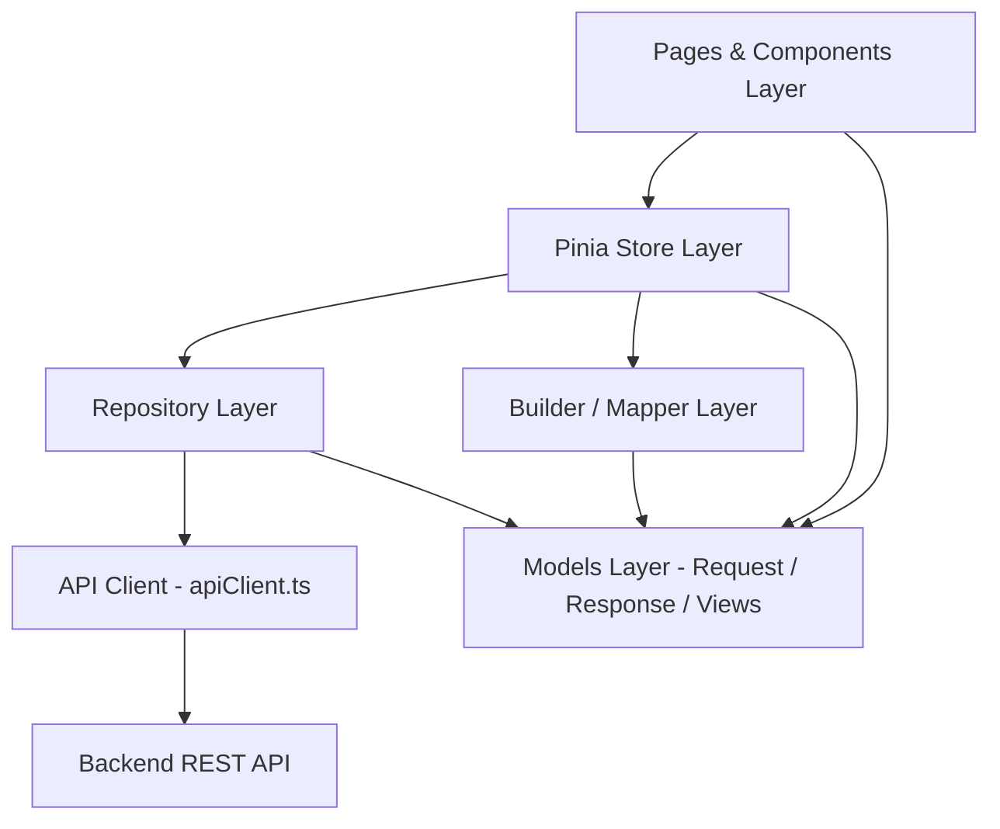
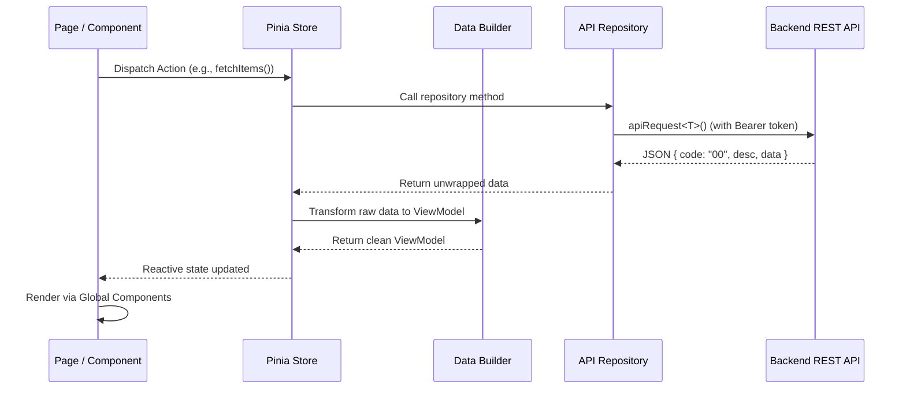

# Application Architecture & Development Guide

A clean, scalable, layered architectural framework for **Nuxt 3 enterprise admin applications**. This document serves as the standard development guide for external contributors, contractors, and partners.

---

## 🏛️ 1. Architecture Overview

The application follows a **Clean Layered Architecture** that decouples the user interface from backend communication, state management, and business logic.



### The 6 Core Layers:

| Layer | Location | Purpose | Key Rules |
| :--- | :--- | :--- | :--- |
| **1. Models** | `models/` | Type definitions for requests, responses, and UI state | Strictly use TypeScript `interface`s. Never use classes for DTOs. |
| **2. API Client** | `data/networks/apiClient.ts` | Central HTTP client & network wrapper | Uses `apiRequest<T>()` and `toFormData()`. Handles auth tokens and response unwrapping. |
| **3. Repositories** | `data/repositories/` | Domain API gateways | Stateless async functions calling `apiRequest<T>()`. |
| **4. Builders** | `data/builders/` | Data transformations & sanitization | Transforms raw API responses into UI ViewModels (null fallbacks, formatting, localization). |
| **5. Stores** | `stores/` | Reactive state management & orchestration | Pinia stores. Always wrap repository calls in `useDialog().catchError()`. |
| **6. UI Layer** | `pages/` & `components/` | Visual presentation & user interactions | Uses custom global components (`GlobalCustom*`) for consistent design and auto-validation. |

---

## 📁 2. Standard Folder Structure

```
source/
├── assets/                       # Static styles, global SCSS variables, brand assets
│   ├── scss/                     # Custom SCSS stylesheets & theme overrides
│   └── images/                   # Local static illustrations & icons
│
├── components/                   # Vue 3 Components
│   ├── global/                   # Reusable Design System wrappers (Auto-imported globally)
│   │   ├── CustomActionBtn.vue   # Standard action button (consistent typography & ripple)
│   │   ├── CustomIconButton.vue  # Icon button with tooltip & hover feedback
│   │   ├── CustomCardTitle.vue   # Standard header bar with title, subtitle, and action slot
│   │   ├── CustomCardFilter.vue  # Search & filter bar with automatic required validation
│   │   ├── CustomCardTable.vue   # Table card wrapper displaying total count and export slot
│   │   ├── CustomTable.vue       # Standardized data table
│   │   ├── TablePagination.vue   # Reusable pagination component
│   │   ├── CustomStatusTag.vue   # Status badge chips (A=Active, I=Inactive, P=Pending, R=Rejected)
│   │   ├── CustomTextField.vue   # Input text field with built-in grid column responsiveness
│   │   ├── CustomDropdown.vue    # Select dropdown wrapper with standard options binding
│   │   ├── CustomDatePicker.vue  # Date picker component
│   │   ├── CustomTextArea.vue    # Multi-line text field
│   │   ├── CustomImageUploader.vue # Drag-and-drop file/image upload with order & delete
│   │   ├── CustomImageCard.vue   # Thumbnail display card with modal preview trigger
│   │   ├── CustomDialogCard.vue  # Config-driven modal dialog with auto required validation
│   │   └── AppDialog.vue         # SweetAlert modal notification wrapper
│   │
│   ├── dialog/                   # Shared alert, confirmation, and overlay dialogs
│   │   ├── CardSuccess.vue       # Operation success modal
│   │   ├── CardWarning.vue       # Warning / confirmation modal
│   │   └── Overlay.vue           # Global loading overlay spinner
│   │
│   └── {feature}/                # Feature-specific child components (e.g. components/items/)
│
├── composables/                  # Nuxt 3 Composables
│   ├── useDialog.ts              # Global dialog and error handling (useDialog().catchError())
│   ├── useAuth.ts                # Session state, authentication tokens, user roles
│   └── useDate.ts                # Date formatting and manipulation utilities
│
├── config/                       # Environment configuration files (dev, staging, prod)
│
├── constants/                    # Application constants, enum mappings, and color tokens
│
├── data/                         # Data Access & Transformation
│   ├── networks/                 # HTTP network client
│   │   ├── apiClient.ts          # apiRequest<T>() wrapper, toFormData(), ApiError class
│   │   └── index.ts              # Network exports
│   │
│   ├── repositories/             # API Repositories (One per feature domain)
│   │   ├── item.ts               # Feature API calls (GET, POST, PUT, DELETE)
│   │   └── index.ts              # Central repository registry
│   │
│   └── builders/                 # Data Transformers (View Model <-> API DTO)
│       ├── item.ts               # Feature builder (formatting, null fallbacks)
│       └── index.ts              # Central builder registry
│
├── layouts/                      # Nuxt Layouts (default admin shell, auth screen)
│
├── middleware/                   # Nuxt Route Guards (auth check, role-based access)
│
├── models/                       # Type Definitions (Pure TypeScript interfaces)
│   ├── requestbody/              # API Request payload interfaces
│   │   ├── item.ts               # Request namespace (e.g., ItemReq.SaveItemReq)
│   │   └── index.ts              # Re-exports all request types
│   │
│   ├── responsebody/             # API Response payload interfaces
│   │   ├── commonRes.ts          # CommonResponseData { code, desc, respId, data }
│   │   ├── item.ts               # Feature response interfaces
│   │   └── index.ts              # Re-exports all response types
│   │
│   └── views/                    # UI View Models (Component-tailored types)
│       ├── item.ts               # ItemViewModel, ItemListViewModel
│       └── index.ts              # Re-exports all view models
│
├── pages/                        # Nuxt 3 File-based Routing
│   ├── index.vue                 # Dashboard
│   ├── login.vue                 # Authentication page
│   └── {feature}/                # Feature route directory (e.g., pages/items/index.vue)
│
├── plugins/                      # Nuxt Plugins (Vuetify, Axios, Viewer.js, etc.)
│
├── stores/                       # Pinia Stores (Global state & feature orchestration)
│   ├── item.ts                   # Feature store
│   └── index.ts                  # Store exports
│
├── utils/                        # General helper utilities (formatters, file export helpers)
│
├── app.vue                       # Nuxt root component
├── nuxt.config.ts                # Nuxt configuration
├── package.json                  # Dependencies and scripts
└── tsconfig.json                 # TypeScript compiler configuration
```

---

## 🚀 3. End-to-End Implementation Flow (The 5 Steps)

When implementing any new feature, follow this exact workflow:



---

### Step 1: Define TypeScript Models (`models/`)

All data structures must be strictly defined as TypeScript `interface`s.

#### 1. Request Interface (`models/requestbody/item.ts`):
```typescript
export namespace ItemReq {
  export interface QueryItemReq {
    q?: string;
    status?: string;
    page?: number;
    limit?: number;
  }

  export interface SaveItemReq {
    id?: string | number;
    titleLo: string;
    titleEn: string;
    category: string;
    price: number;
    status?: string;
    imageFile?: File | Blob | null;
  }
}
```

#### 2. Response Interface (`models/responsebody/item.ts`):
```typescript
export interface ItemDataResp {
  id: number;
  itemCode: string;
  titleLo: string;
  titleEn: string;
  category: string;
  price: number;
  status: string; // "A" | "I"
  createdAt: string;
  imageUrl?: string | null;
}
```

#### 3. View Model (`models/views/item.ts`):
```typescript
export interface ItemViewModel {
  id: number | string;
  itemCode: string;
  titleLo: string;
  titleEn: string;
  priceFormatted: string; // e.g., "50,000"
  isActive: boolean;
  statusTag: "A" | "I";
  imageUrl: string;
}
```

---

### Step 2: Implement the Repository (`data/repositories/`)

Use `apiRequest<T>()` and `toFormData(body)` from `@/data/networks/apiClient`. 

> [!IMPORTANT]
> **NEVER** write manual `new FormData()` or repetitive `formData.append(...)` lines. Pass the typed payload to `toFormData(body)`.

```typescript
// data/repositories/item.ts
import { apiRequest, toFormData } from "@/data/networks/apiClient";
import type { ItemReq } from "@/models/requestbody";
import type { ItemDataResp } from "@/models/responsebody/item";
import type { CommonResponseData } from "@/models/responsebody/commonRes";

export const itemRepositories = {
  // GET: with query parameters
  async getItems(query?: ItemReq.QueryItemReq) {
    const { data } = await apiRequest<ItemDataResp[]>("/items/list", {
      method: "GET",
      query,
    });
    return data;
  },

  // POST: Multipart / FormData upload
  async saveItem(body: ItemReq.SaveItemReq) {
    const { data } = await apiRequest<CommonResponseData>("/items/save", {
      method: "POST",
      body: toFormData(body),
    });
    return data;
  },

  // DELETE
  async deleteItem(id: string | number) {
    const { data } = await apiRequest<CommonResponseData>(`/items/delete/${id}`, {
      method: "DELETE",
    });
    return data;
  },
};
```

Export your repository centrally in `data/repositories/index.ts`:
```typescript
export { itemRepositories } from "./item";
```

---

### Step 3: Implement the Builder (`data/builders/`)

The Builder encapsulates default fallbacks (`"-"`), localized lists, and formatting rules. This keeps transformations out of the UI components and stores.

```typescript
// data/builders/item.ts
import type { ItemDataResp } from "@/models/responsebody/item";
import type { ItemViewModel } from "@/models/views/item";

export const itemBuilder = {
  toItemViewModelList(data: ItemDataResp[] | null | undefined): ItemViewModel[] {
    if (!data || !Array.isArray(data)) return [];

    return data.map((item) => {
      const price = Number(item.price || 0);

      return {
        id: item.id,
        itemCode: item.itemCode || "-",
        titleLo: item.titleLo || "-",
        titleEn: item.titleEn || "-",
        priceFormatted: price.toLocaleString("en-US"),
        isActive: item.status === "A",
        statusTag: item.status === "A" ? "A" : "I",
        imageUrl: item.imageUrl || "",
      };
    });
  },
};
```

Export your builder in `data/builders/index.ts`:
```typescript
export { itemBuilder } from "./item";
```

---

### Step 4: Manage State in Pinia (`stores/`)

> [!IMPORTANT]
> Always wrap repository calls in `useDialog().catchError(() => ...)`. This safely intercepts backend errors, displays standardized error alerts, and returns `null` safely without unhandled promise rejections.

```typescript
// stores/item.ts
import { defineStore } from "pinia";
import { itemRepositories } from "@/data/repositories";
import { itemBuilder } from "@/data/builders";
import { useDialog } from "@/composables/useDialog";
import type { ItemViewModel } from "@/models/views/item";
import type { ItemReq } from "@/models/requestbody";

export const useItemStore = defineStore("itemStore", {
  state: () => ({
    loading: false,
    filter: { q: "", status: "" } as ItemReq.QueryItemReq,
    items: [] as ItemViewModel[],
  }),

  actions: {
    async fetchItems() {
      this.loading = true;
      try {
        const rawData = await useDialog().catchError(() =>
          itemRepositories.getItems(this.filter),
        );
        this.items = itemBuilder.toItemViewModelList(rawData);
      } finally {
        this.loading = false;
      }
    },

    async saveItem(payload: ItemReq.SaveItemReq) {
      this.loading = true;
      try {
        const res = await useDialog().catchError(() =>
          itemRepositories.saveItem(payload),
        );
        if (res) {
          await useDialog().success("Success", "Item saved successfully");
          await this.fetchItems();
        }
        return res;
      } finally {
        this.loading = false;
      }
    },
  },
});
```

---

### Step 5: Build UI with Global Components (`pages/` & `components/`)

Assemble the page utilizing the pre-built global components.

```vue
<!-- pages/items/index.vue -->
<script setup lang="ts">
import { onMounted, ref } from "vue";
import { useItemStore } from "@/stores/item";
import type { FilterFieldConfig } from "@/components/global/CustomCardFilter.vue";

const itemStore = useItemStore();

// 1. Search Bar Configuration (Supports automatic required validation)
const filterFields = ref<FilterFieldConfig[]>([
  {
    type: "text",
    label: "Search by Name / Code",
    value: "",
    prefixIcon: "mdi-magnify",
  },
  {
    type: "dropdown",
    label: "Status",
    items: [
      { title: "All", value: "" },
      { title: "Active", value: "A" },
      { title: "Inactive", value: "I" },
    ],
    value: "",
  },
]);

const handleSearch = () => {
  itemStore.filter.q = String(filterFields.value[0].value ?? "");
  itemStore.filter.status = String(filterFields.value[1].value ?? "");
  itemStore.fetchItems();
};

onMounted(() => {
  itemStore.fetchItems();
});
</script>

<template>
  <v-container fluid class="pa-4">
    <!-- 1. Page Title & Action Bar -->
    <GlobalCustomCardTitle
      title="Items Management"
      subtitle="View, create, and manage system catalog items"
    >
      <template #action>
        <GlobalCustomActionBtn
          icon="mdi-plus"
          label="New Item"
          to="/items/create"
        />
      </template>
    </GlobalCustomCardTitle>

    <!-- 2. Search & Filter Bar -->
    <GlobalCustomCardFilter
      :fields="filterFields"
      title="Filters"
      button-label="Search"
      @search="handleSearch"
    />

    <!-- 3. Table Wrapper & Table -->
    <GlobalCustomCardTable :total="itemStore.items.length">
      <GlobalCustomTable
        :headers="[
          { title: 'Code', key: 'itemCode' },
          { title: 'Name (Lao)', key: 'titleLo' },
          { title: 'Name (English)', key: 'titleEn' },
          { title: 'Price', key: 'priceFormatted' },
          { title: 'Status', key: 'statusTag' },
        ]"
        :items="itemStore.items"
        :loading="itemStore.loading"
      >
        <template #item.statusTag="{ item }">
          <GlobalCustomStatusTag :status="item.statusTag" />
        </template>
      </GlobalCustomTable>
    </GlobalCustomCardTable>
  </v-container>
</template>
```

---

## 🛡️ 4. Core Development Best Practices

### 1. Zero Manual `FormData` Append
Never manually instantiate `new FormData()` or chain `.append(...)` in components or stores. Use `toFormData(body)` from `@/data/networks/apiClient`.

### 2. Standardized Error Handling
Never leave raw unhandled `try/catch` rejections on API calls. Always wrap store repository invocations in `useDialog().catchError(() => ...)`.

### 3. Image Upload & Preview Standards
- **Uploading**: Always use `<GlobalCustomImageUploader>` for drag-and-drop file upload, ordering, and deletion.
- **Previewing**: Use the `v-viewer` directive with `<GlobalCustomImageCard>`. Never build ad-hoc `v-dialog` modals for previewing images to prevent state desynchronization.

### 4. Multilingual Input Fields
Avoid copy-pasting duplicate input fields across languages (Lao, English, Chinese, Vietnamese). Maintain a configuration array in the component script and loop dynamically:
```vue
<v-col
  v-for="lang in languageList"
  :key="lang.code"
  cols="12"
  md="6"
>
  <GlobalCustomTextField
    v-model="form[lang.key]"
    :label="`${lang.label} Title`"
  />
</v-col>
```

### 5. Form Dirty Checking Before API Call
When editing an existing record, capture a string snapshot of the form on mount (`const initial = JSON.stringify(form)`). On submit, compare:
```typescript
if (initial === JSON.stringify(form)) {
  // No changes made; close modal without making an API call
  return onBack();
}
```

### 6. Strict Type Safety
All code must pass static type checking cleanly:
```bash
yarn typecheck
```
Ensure **0 errors** before submitting any work.
