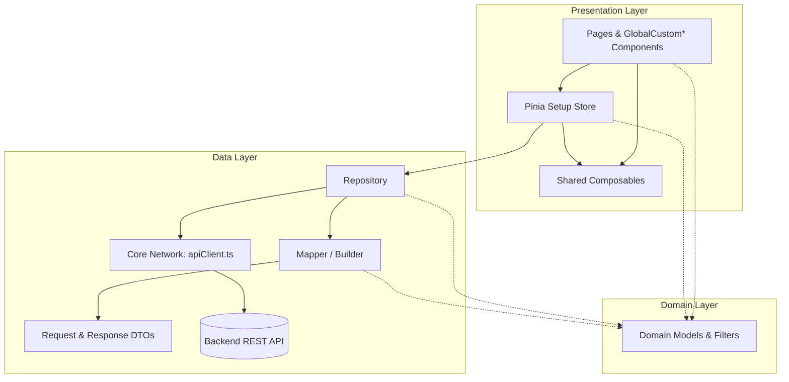
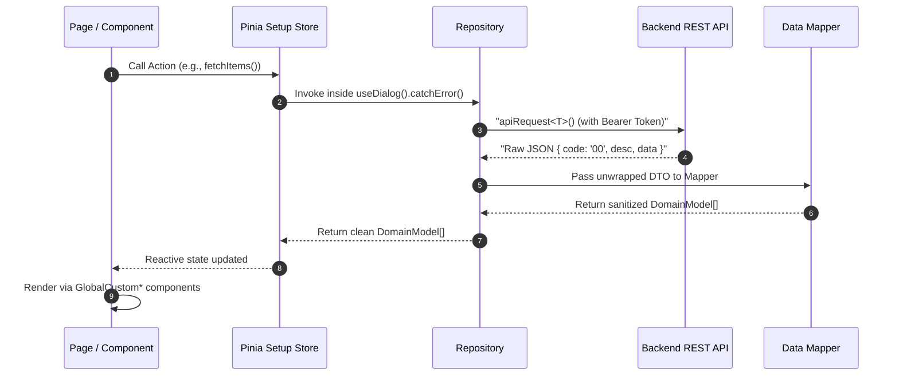

Application Architecture & Development Guide

A clean, scalable, layered architectural framework for Nuxt 3 enterprise admin applications. This document serves as the standard development guide for internal engineers, external contributors, contractors, and partners.

📑 Table of Contents

Architecture Overview

Standard Folder Structure

Global UI Component Reference

End-to-End Implementation Flow (The 5 Steps)

Core Development Standards & Best Practices

🏛️ 1. Architecture Overview

The application enforces a Clean Architecture divided into Core Infrastructure, Domain, Data, and Presentation layers. This decouples the user interface from backend data shapes, network communication, and business orchestration.

Architectural Layers & Responsibilities

Layer

Location

Purpose

Strict Rules

0. Core Infrastructure

core/

Central HTTP client & base network types

Uses apiRequest<T>() and toFormData(). Handles auth tokens and response unwrapping.

1. Domain Layer

domain/models/

Pure UI & business models

Strictly TypeScript interfaces and types. Completely decoupled from raw backend JSON shapes.

2. Data Layer (DTOs)

data/dtos/

Backend API contracts (Request & Response)

Combines Request and Response payloads into a single {feature}.dto.ts file per domain.

2. Data Layer (Mappers)

data/mappers/

Data sanitization & formatting

Transforms raw RespDTO into clean DomainModel (null fallbacks, currency/date formatting).

2. Data Layer (Repos)

data/repositories/

Domain API gateways

Calls apiRequest<T>() and runs Mapper automatically. Always returns clean Domain Models.

3. Presentation Layer

stores/, pages/, components/

Reactive state & visual UI

Pinia Setup Stores wrap repo calls in useDialog().catchError(). UI uses <GlobalCustom*>.

📁 2. Standard Folder Structure

source/
├── assets/                       # Static styles, global SCSS variables, brand assets
│   ├── scss/                     # Custom SCSS stylesheets & theme overrides
│   └── images/                   # Local static illustrations & icons
│
├── core/                         # 🧱 0. CORE INFRASTRUCTURE
│   ├── network/
│   │   ├── apiClient.ts          # apiRequest<T>() wrapper, toFormData(), ApiError class
│   │   └── index.ts              # Network exports
│   └── types/
│       └── common.dto.ts         # CommonResponseData<T> { code, desc, respId, data }
│
├── domain/                       # 🧠 1. DOMAIN LAYER (UI & Business Contracts)
│   └── models/
│       ├── item.model.ts         # Clean UI Models & Filter interfaces (e.g., ItemModel)
│       └── index.ts              # Re-exports all domain models
│
├── data/                         # 🔌 2. DATA LAYER (Backend Communication & Mapping)
│   ├── dtos/                     # API Request & Response DTOs (1 file per feature)
│   │   ├── item.dto.ts           # SaveItemReqDTO, ItemRespDTO
│   │   └── index.ts              # Central DTO registry
│   │
│   ├── mappers/                  # Data Transformers (DTO <-> Domain Model)
│   │   ├── item.mapper.ts        # Sanitizes nulls ("-"), formats numbers/dates/status
│   │   └── index.ts              # Central mapper registry
│   │
│   └── repositories/             # API Gateways (Calls apiRequest + Mapper)
│       ├── item.repo.ts          # Feature API calls returning clean Domain Models
│       └── index.ts              # Central repository registry
│
├── composables/                  # 🛠️ SHARED LOGIC (Auto-imported by Nuxt 3)
│   ├── useDialog.ts              # Global dialog & error boundary (useDialog().catchError())
│   ├── useDirtyForm.ts           # Form snapshot & dirty-checking utility
│   ├── useAuth.ts                # Session state, authentication tokens, user roles
│   └── useDate.ts                # Date formatting and manipulation utilities
│
├── stores/                       # 📦 3. PRESENTATION STATE (Auto-imported Pinia Setup Stores)
│   ├── item.store.ts             # Feature Setup Store (state + actions)
│   └── index.ts                  # Store exports
│
├── components/                   # 🎨 3. PRESENTATION UI (Vue 3 Components)
│   ├── global/                   # Auto-imported Design System wrappers (Prefixed Global*)
│   ├── dialog/                   # Shared alert, confirmation, and overlay dialogs
│   │   ├── CardSuccess.vue       # Operation success modal
│   │   ├── CardWarning.vue       # Warning / confirmation modal
│   │   └── Overlay.vue           # Global loading overlay spinner
│   └── {feature}/                # Feature-specific child components (e.g., components/items/)
│
├── pages/                        # 📄 ROUTES (Nuxt 3 File-based Routing)
│   ├── index.vue                 # Dashboard
│   ├── login.vue                 # Authentication page
│   └── {feature}/                # Feature route directory (e.g., pages/items/index.vue)
│
├── config/                       # Environment configuration files (dev, staging, prod)
├── constants/                    # Application constants, enum mappings, and color tokens
├── layouts/                      # Nuxt Layouts (default admin shell, auth screen)
├── middleware/                   # Nuxt Route Guards (auth check, role-based access)
├── plugins/                      # Nuxt Plugins (Vuetify, Viewer.js, etc.)
├── utils/                        # General pure helper functions (validators, exporters)
├── app.vue                       # Nuxt root component
├── nuxt.config.ts                # Nuxt configuration
├── package.json                  # Dependencies and scripts
└── tsconfig.json                 # TypeScript compiler configuration

🧩 3. Global UI Component Reference

All components inside components/global/ are automatically registered by Nuxt 3 with the Global prefix. Always use these over raw Vuetify tags to guarantee consistent design and validation.

Category

Component Tag

Description

Layout & Cards

<GlobalCustomCardTitle>

Standard page header bar with title, subtitle, and #action slot.

<GlobalCustomCardFilter>

Config-driven search & filter bar with automatic required validation.

<GlobalCustomCardTable>

Table card wrapper displaying total record count and export slot.

<GlobalCustomDialogCard>

Config-driven modal dialog with automatic required validation.

Tables & Tags

<GlobalCustomTable>

Standardized data table with loading states and custom cell slots.

<GlobalTablePagination>

Reusable pagination control component.

<GlobalCustomStatusTag>

Status badge chip (A=Active, I=Inactive, P=Pending, R=Rejected).

Form Controls

<GlobalCustomTextField>

Input text field with built-in responsive grid column sizing.

<GlobalCustomTextArea>

Multi-line text field wrapper.

<GlobalCustomDropdown>

Select dropdown wrapper with standardized options binding.

<GlobalCustomDatePicker>

Standardized date picker component.

Media & Upload

<GlobalCustomImageUploader>

Drag-and-drop file/image uploader with ordering and deletion.

<GlobalCustomImageCard>

Thumbnail display card integrated with v-viewer modal preview.

Actions & Alerts

<GlobalCustomActionBtn>

Standard action button with consistent typography and ripple.

<GlobalCustomIconButton>

Icon button with built-in tooltip and hover feedback.

<GlobalAppDialog>

Global SweetAlert modal notification wrapper.

🚀 4. End-to-End Implementation Flow (The 5 Steps)

When building a new feature, follow this exact sequence. Note how the Repository automatically invokes the Mapper, keeping the Pinia Store lightweight and free of data-formatting logic.

Step 1: Define Domain Models & Data DTOs (domain/ & data/dtos/)

Separate what the UI needs (domain/models/) from what the Backend expects/returns (data/dtos/).

A. Domain Model (domain/models/item.model.ts)

export type ItemStatus = "A" | "I";

export interface ItemModel {
  id: number | string;
  itemCode: string;
  titleLo: string;
  titleEn: string;
  priceFormatted: string; // e.g., "50,000"
  isActive: boolean;
  statusTag: ItemStatus;
  imageUrl: string;
}

export interface ItemFilter {
  q?: string;
  status?: string;
  page?: number;
  limit?: number;
}

B. Data Transfer Objects (data/dtos/item.dto.ts)

Combine Request and Response interfaces for a feature into a single file:

export interface SaveItemReqDTO {
  id?: string | number;
  titleLo: string;
  titleEn: string;
  category: string;
  price: number;
  status?: string;
  imageFile?: File | Blob | null;
}

export interface ItemRespDTO {
  id: number;
  itemCode: string;
  titleLo: string;
  titleEn: string;
  category: string;
  price: number;
  status: string; // "A" | "I"
  createdAt: string;
  imageUrl?: string | null;
}

Step 2: Implement the Mapper (data/mappers/)

The Mapper encapsulates default fallbacks ("-"), localized fields, and formatting rules so raw backend quirks never leak into Stores or Components.

// data/mappers/item.mapper.ts
import type { ItemRespDTO } from "@/data/dtos/item.dto";
import type { ItemModel } from "@/domain/models/item.model";

export const itemMapper = {
  toDomain(dto: ItemRespDTO): ItemModel {
    const price = Number(dto.price || 0);

    return {
      id: dto.id,
      itemCode: dto.itemCode || "-",
      titleLo: dto.titleLo || "-",
      titleEn: dto.titleEn || "-",
      priceFormatted: price.toLocaleString("en-US"),
      isActive: dto.status === "A",
      statusTag: dto.status === "A" ? "A" : "I",
      imageUrl: dto.imageUrl || "",
    };
  },

  toDomainList(dtos?: ItemRespDTO[] | null): ItemModel[] {
    if (!Array.isArray(dtos)) return [];
    return dtos.map(this.toDomain);
  },
};

Export centrally in data/mappers/index.ts:

export { itemMapper } from "./item.mapper";

Step 3: Implement the Repository (data/repositories/)

Use apiRequest<T>() and toFormData(body) from @/core/network/apiClient. The repository automatically maps ItemRespDTO into ItemModel before returning.

[!IMPORTANT]
NEVER write manual new FormData() or repetitive formData.append(...) lines. Always pass the typed DTO directly to toFormData(body).

// data/repositories/item.repo.ts
import { apiRequest, toFormData } from "@/core/network/apiClient";
import { itemMapper } from "@/data/mappers";
import type { CommonResponseData } from "@/core/types/common.dto";
import type { ItemRespDTO, SaveItemReqDTO } from "@/data/dtos/item.dto";
import type { ItemFilter, ItemModel } from "@/domain/models/item.model";

export const itemRepository = {
  // GET: Fetches raw DTOs and returns mapped Domain Models
  async getItems(query?: ItemFilter): Promise<ItemModel[]> {
    const { data } = await apiRequest<ItemRespDTO[]>("/items/list", {
      method: "GET",
      query,
    });
    return itemMapper.toDomainList(data);
  },

  // POST: Multipart / FormData upload via toFormData()
  async saveItem(body: SaveItemReqDTO) {
    const { data } = await apiRequest<CommonResponseData>("/items/save", {
      method: "POST",
      body: toFormData(body),
    });
    return data;
  },

  // DELETE
  async deleteItem(id: string | number) {
    const { data } = await apiRequest<CommonResponseData>(`/items/delete/${id}`, {
      method: "DELETE",
    });
    return data;
  },
};

Export centrally in data/repositories/index.ts:

export { itemRepository } from "./item.repo";

Step 4: Manage State in a Pinia Setup Store (stores/)

Use Pinia Setup Syntax (ref, arrow functions) for clean TypeScript inference and Nuxt 3 auto-import support.

[!IMPORTANT]
Always wrap repository calls in useDialog().catchError(() => ...). This intercepts backend/network errors, displays standardized error alerts, and safely returns null without unhandled promise rejections.

// stores/item.store.ts
import { defineStore } from "pinia";
import { itemRepository } from "@/data/repositories";
import type { ItemFilter, ItemModel } from "@/domain/models/item.model";
import type { SaveItemReqDTO } from "@/data/dtos/item.dto";

export const useItemStore = defineStore("itemStore", () => {
  const dialog = useDialog(); // Auto-imported from composables/

  // State
  const loading = ref(false);
  const filter = ref<ItemFilter>({ q: "", status: "" });
  const items = ref<ItemModel[]>([]);

  // Actions
  const fetchItems = async () => {
    loading.value = true;
    try {
      const data = await dialog.catchError(() =>
        itemRepository.getItems(filter.value),
      );
      items.value = data ?? [];
    } finally {
      loading.value = false;
    }
  };

  const saveItem = async (payload: SaveItemReqDTO) => {
    loading.value = true;
    try {
      const res = await dialog.catchError(() =>
        itemRepository.saveItem(payload),
      );
      if (res) {
        await dialog.success("Success", "Item saved successfully");
        await fetchItems();
      }
      return res;
    } finally {
      loading.value = false;
    }
  };

  return {
    loading,
    filter,
    items,
    fetchItems,
    saveItem,
  };
});

Step 5: Build the UI with Global Components (pages/ & components/)

Keep page components thin and declarative by leveraging Nuxt auto-imports and <GlobalCustom*> components.

<!-- pages/items/index.vue -->

<template>
  <v-container fluid class="pa-4">
    <!-- 1. Page Title & Action Bar -->
    <GlobalCustomCardTitle
      title="Items Management"
      subtitle="View, create, and manage system catalog items"
    >
      <template #action>
        <GlobalCustomActionBtn
          icon="mdi-plus"
          label="New Item"
          to="/items/create"
        />
      </template>
    </GlobalCustomCardTitle>

    <!-- 2. Search & Filter Bar -->
    <GlobalCustomCardFilter
      :fields="filterFields"
      title="Filters"
      button-label="Search"
      @search="handleSearch"
    />

    <!-- 3. Table Wrapper & Table -->
    <GlobalCustomCardTable :total="itemStore.items.length">
      <GlobalCustomTable
        :headers="tableHeaders"
        :items="itemStore.items"
        :loading="itemStore.loading"
      >
        <template #item.statusTag="{ item }">
          <GlobalCustomStatusTag :status="item.statusTag" />
        </template>
      </GlobalCustomTable>
    </GlobalCustomCardTable>
  </v-container>
</template>

🛡️ 5. Core Development Standards & Best Practices

1. Zero Manual FormData Append

Never manually instantiate new FormData() or chain .append(...) in components, stores, or repositories. Always pass your typed request DTO to toFormData(body) from @/core/network/apiClient.

2. Standardized Error Handling

Never leave raw unhandled try/catch blocks on API calls. Always wrap store repository invocations in useDialog().catchError(() => ...).

3. Image Upload & Preview Standards

Uploading: Always use <GlobalCustomImageUploader> for drag-and-drop file upload, ordering, and deletion.

Previewing: Use the v-viewer directive with <GlobalCustomImageCard>. Never build ad-hoc v-dialog modals for previewing images to prevent state desynchronization.

4. Dynamic Multilingual Input Fields

Avoid copy-pasting duplicate input fields across supported languages (Lao, English, Chinese, Vietnamese). Maintain a configuration array in 

<template>
  <v-row>
    <v-col
      v-for="lang in languageList"
      :key="lang.code"
      cols="12"
      md="6"
    >
      <GlobalCustomTextField
        v-model="form[lang.key]"
        :label="`${lang.label} Title`"
      />
    </v-col>
  </v-row>
</template>

5. Form Dirty-Checking via useDirtyForm Composable

When editing an existing record, use the useDirtyForm composable (or snapshot comparison) to avoid unnecessary API calls when no fields were modified:

// composables/useDirtyForm.ts
export const useDirtyForm = <T extends object>(formState: T) => {
  const initialSnapshot = ref(JSON.stringify(formState));

  const resetSnapshot = () => {
    initialSnapshot.value = JSON.stringify(formState);
  };

  const isDirty = computed(
    () => initialSnapshot.value !== JSON.stringify(formState),
  );

  return { isDirty, resetSnapshot };
};

Usage inside an edit page or modal:

const { isDirty } = useDirtyForm(form);

const handleSubmit = async () => {
  if (!isDirty.value) {
    // No changes made; close modal/page without making an API call
    return onBack();
  }
  await itemStore.saveItem(form);
};

6. Strict Type Safety

All code must pass static type checking cleanly:

yarn typecheck

Ensure 0 errors before opening a Pull Request or submitting any work.
