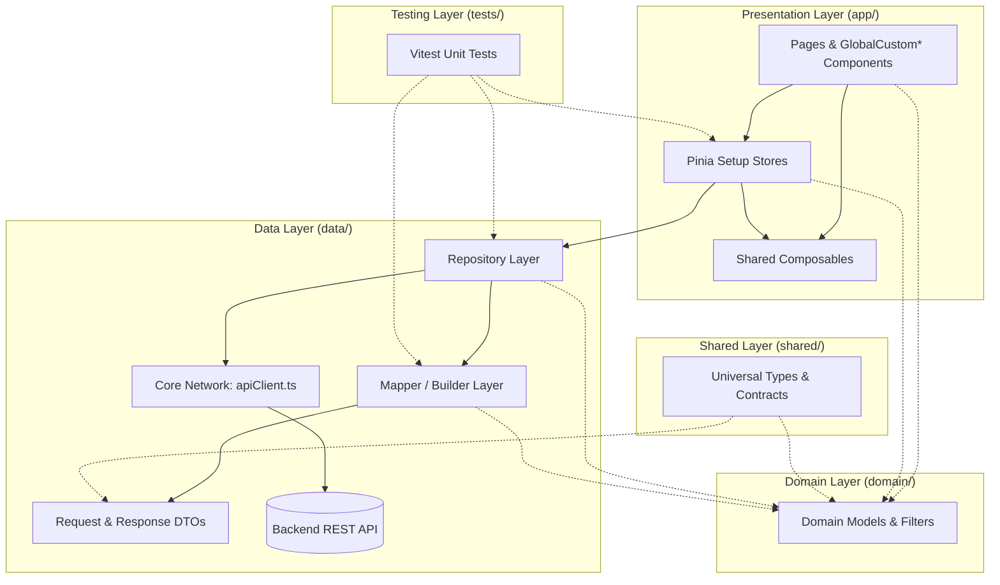

# Application Architecture & Development Guide (Nuxt 4)

A clean, scalable, layered architectural framework tailored for **Nuxt 4 enterprise admin applications**. This document serves as the standard development guide for internal engineers, external contributors, contractors, and technical partners.

---

## 📑 Table of Contents

- [🏛️ 1. Architecture Overview](#️-1-architecture-overview)
- [✨ 2. What's New & Different in Nuxt 4](#-2-whats-new--different-in-nuxt-4)
- [📁 3. Standard Nuxt 4 Folder Structure](#-3-standard-nuxt-4-folder-structure)
- [🧩 4. Global UI Component Reference](#-4-global-ui-component-reference)
- [🚀 5. End-to-End Implementation Flow (The 6 Steps)](#-5-end-to-end-implementation-flow-the-6-steps)
- [⚙️ 6. Automated Feature Scaffolding (CLI)](#️-6-automated-feature-scaffolding-cli)
- [🛡️ 7. Core Development Standards & Best Practices](#️-7-core-development-standards--best-practices)
- [⚙️ 8. Nuxt 4 Configuration & Compatibility Mode](#️-8-nuxt-4-configuration--compatibility-mode)

---

## 🏛️ 1. Architecture Overview

The application enforces a **Clean, Layered Architecture** adapted to Nuxt 4's modernized filesystem conventions. It strictly decouples user interface rendering from backend contracts, network transport, and state management while ensuring 100% unit-testability in isolation.



### Architectural Layers & Responsibilities

| Layer | Location | Purpose | Strict Rules |
| :--- | :--- | :--- | :--- |
| **0. Core Infrastructure** | `core/` | Central HTTP client & network gateway | Uses `apiRequest<T>()` and `toFormData()`. Handles auth tokens, refresh tokens, and standardized unwrapping. |
| **1. Domain Layer** | `domain/models/` | Clean business entities & UI models | Strictly TypeScript interfaces. Completely decoupled from raw backend JSON schemas. |
| **2. Data Layer (DTOs)** | `data/dtos/` | Backend API contracts (Request & Response) | Combines Request and Response payloads into a single `{feature}.dto.ts` file per domain. |
| **2. Data Layer (Mappers)** | `data/mappers/` | Data sanitization & formatting | Transforms raw DTOs into clean Domain Models (null fallbacks `"-"`, currency/date formatting). |
| **2. Data Layer (Repos)** | `data/repositories/` | Domain API gateways | Calls `apiRequest<T>()` and automatically maps responses. Always returns clean Domain Models. |
| **3. Shared Layer** | `shared/` | Universal types & isomorphic utilities | Accessible by both client (`app/`) and server (`server/`) without bundle pollution. |
| **4. Presentation Layer** | `app/` | UI components, pages, state & routing | All frontend code lives inside `app/`. Stores wrap repo calls in `useDialog().catchError()`. |
| **5. Testing Layer** | `tests/unit/` | Isolated unit testing (Vitest) | Every feature must include isolated tests for Mapper, Repository, and Pinia Store. |

---

## ✨ 2. What's New & Different in Nuxt 4

Nuxt 4 introduces fundamental structural improvements that enhance performance, monorepo readiness, and code organization:

1. **`app/` Application Directory**:
   All frontend presentation files (`pages/`, `components/`, `composables/`, `layouts/`, `middleware/`, `plugins/`, `assets/`, `app.vue`) now reside inside `app/` instead of cluttering the root folder.
2. **`shared/` Directory**:
   Nuxt 4 provides a first-class `shared/` directory. Code here can be imported seamlessly in both client-side Vue (`app/`) and Nitro server endpoints (`server/`).
3. **Improved Auto-Imports**:
   Nuxt 4 enhances auto-import tree-shaking and resolution speed.
4. **Vue 3.5+ Reactivity & TypeScript 5+**:
   Full support for modern Vue features including reactive props destructuring and improved compiler performance.
5. **Compatibility Mode**:
   Projects running Nuxt 3.x can enable Nuxt 4 conventions today via `future: { compatibilityVersion: 4 }` in `nuxt.config.ts`.

---

## 📁 3. Standard Nuxt 4 Folder Structure

```
source/
├── app/                          # 🎨 NUXT 4 FRONTEND ROOT
│   ├── assets/                   # SCSS stylesheets, fonts, brand graphics
│   │   ├── scss/                 # Custom theme variables & Vuetify overrides
│   │   └── images/               # Local icons & static illustrations
│   │
│   ├── components/               # Vue 3 Components
│   │   ├── global/               # Auto-imported Design System wrappers (Prefixed Global*)
│   │   ├── dialog/               # Shared alert, confirmation, and overlay dialogs
│   │   │   ├── CardSuccess.vue   # Operation success modal
│   │   │   ├── CardWarning.vue   # Warning / confirmation modal
│   │   │   └── Overlay.vue       # Global loading overlay spinner
│   │   └── {feature}/            # Feature-specific child components (e.g. app/components/items/)
│   │
│   ├── composables/              # Frontend Composables (Auto-imported by Nuxt 4)
│   │   ├── useDialog.ts          # Global dialog & error boundary (useDialog().catchError())
│   │   ├── useDirtyForm.ts       # Form snapshot & dirty-checking utility
│   │   ├── useAuth.ts            # Session state, authentication tokens, user roles
│   │   └── useDate.ts            # Date formatting and manipulation utilities
│   │
│   ├── layouts/                  # Nuxt Layouts (default admin shell, auth screen)
│   ├── middleware/               # Client Route Guards (auth check, role-based access)
│   ├── pages/                    # Nuxt 4 File-based Routing (e.g. app/pages/items/index.vue)
│   ├── plugins/                  # Vue client plugins (Vuetify, Viewer.js, etc.)
│   ├── stores/                   # Pinia Setup Stores (Auto-imported)
│   │   ├── item.store.ts         # Feature Setup Store (state + actions)
│   │   └── index.ts              # Store exports
│   │
│   ├── app.vue                   # Nuxt root component
│   └── router.options.ts         # Custom router scroll behavior and history
│
├── core/                         # 🧱 0. CORE INFRASTRUCTURE
│   ├── network/
│   │   ├── apiClient.ts          # apiRequest<T>() wrapper, toFormData(), ApiError class
│   │   └── index.ts              # Network exports
│   └── types/
│       └── common.dto.ts         # CommonResponseData<T> { code, desc, respId, data }
│
├── domain/                       # 🧠 1. DOMAIN LAYER (UI & Business Contracts)
│   └── models/
│       ├── item.model.ts         # Clean UI Models & Filter interfaces (e.g., ItemModel)
│       └── index.ts              # Central domain models export
│
├── data/                         # 🔌 2. DATA LAYER (Backend Communication & Mapping)
│   ├── dtos/                     # API Request & Response DTOs (1 file per feature)
│   │   ├── item.dto.ts           # SaveItemReqDTO, ItemRespDTO
│   │   └── index.ts              # Central DTO registry
│   │
│   ├── mappers/                  # Data Transformers (DTO <-> Domain Model)
│   │   ├── item.mapper.ts        # Sanitizes nulls ("-"), formats numbers/dates/status
│   │   └── index.ts              # Central mapper registry
│   │
│   └── repositories/             # API Gateways (Calls apiRequest + Mapper)
│       ├── item.repo.ts          # Feature API calls returning clean Domain Models
│       └── index.ts              # Central repository registry
│
├── shared/                       # 🌐 NUXT 4 SHARED DIRECTORY (Client & Nitro Isomorphic)
│   ├── types/                    # Universal types shared between frontend & server
│   └── utils/                    # Pure isomorphic utilities
│
├── server/                       # ⚡ NITRO SERVER ENGINE (Backend / API routes)
│   ├── api/                      # Server-side API endpoints & BFF proxies
│   ├── middleware/               # Server-side request logging & security headers
│   └── utils/                    # Server utilities
│
├── tests/                        # 🧪 4. TESTING LAYER (Vitest Unit Tests)
│   └── unit/
│       └── {feature}/            # Feature unit test suite (e.g., tests/unit/item/)
│           ├── item.mapper.spec.ts
│           ├── item.repo.spec.ts
│           └── item.store.spec.ts
│
├── scripts/                      # ⚙️ CLI AUTOMATION
│   └── make-feature.mjs          # Scaffolds Domain, DTO, Mapper, Repo, Store & Unit Tests
│
├── public/                       # Raw static assets served at root
├── nuxt.config.ts                # Nuxt configuration (with compatibilityVersion: 4)
├── vitest.config.ts              # Vitest unit test configuration
├── package.json                  # Dependencies and scripts
└── tsconfig.json                 # TypeScript compiler configuration
```

---

## 🧩 4. Global UI Component Reference

All components inside `app/components/global/` are automatically registered by Nuxt with the `Global` prefix. Always use these over raw Vuetify tags to guarantee uniform UX and automated validation.

| Category | Component Tag | Description |
| :--- | :--- | :--- |
| **Layout & Cards** | `<GlobalCustomCardTitle>` | Standard page header bar with title, subtitle, and `#action` slot. |
| | `<GlobalCustomCardFilter>` | Config-driven search & filter bar with automatic required validation. |
| | `<GlobalCustomCardTable>` | Table card wrapper displaying total record count and export slot. |
| | `<GlobalCustomDialogCard>` | Config-driven modal dialog with automatic required validation. |
| **Tables & Tags** | `<GlobalCustomTable>` | Standardized data table with loading states and custom cell slots. |
| | `<GlobalTablePagination>` | Reusable pagination control component. |
| | `<GlobalCustomStatusTag>` | Status badge chip (`A`=Active, `I`=Inactive, `P`=Pending, `R`=Rejected). |
| **Form Controls** | `<GlobalCustomTextField>` | Input text field with built-in responsive grid column sizing. |
| | `<GlobalCustomTextArea>` | Multi-line text field wrapper. |
| | `<GlobalCustomDropdown>` | Select dropdown wrapper with standardized options binding. |
| | `<GlobalCustomDatePicker>` | Standardized date picker component. |
| **Media & Upload** | `<GlobalCustomImageUploader>` | Drag-and-drop file/image uploader with ordering and deletion. |
| | `<GlobalCustomImageCard>` | Thumbnail display card integrated with `v-viewer` modal preview. |
| **Actions & Alerts** | `<GlobalCustomActionBtn>` | Standard action button with consistent typography and ripple. |
| | `<GlobalCustomIconButton>` | Icon button with built-in tooltip and hover feedback. |
| | `<GlobalAppDialog>` | Global SweetAlert modal notification wrapper. |

---

## 🚀 5. End-to-End Implementation Flow (The 6 Steps)

When building a new feature in Nuxt 4, follow this exact sequence. Notice how the Repository layer automatically invokes the Mapper, keeping the Pinia Store lightweight and free of transformation logic.

```mermaid
sequenceDiagram
    autonumber
    participant UI as Page / Component (app/pages/)
    participant Store as Pinia Setup Store (app/stores/)
    participant Repo as Repository (data/repositories/)
    participant API as Backend REST API
    participant Mapper as Data Mapper (data/mappers/)

    UI->>Store: Call Action (e.g., fetchItems())
    Store->>Repo: Invoke inside useDialog().catchError()
    Repo->>API: apiRequest&lt;T&gt;() (with Bearer Token)
    API-->>Repo: Raw JSON { code: '00', desc, data }
    Repo->>Mapper: Pass unwrapped DTO to Mapper
    Mapper-->>Repo: Return sanitized DomainModel[]
    Repo-->>Store: Return clean DomainModel[]
    Store-->>UI: Reactive state updated
    UI->>UI: Render via GlobalCustom* components
```

---

### Step 1: Define Domain Models & Data DTOs (`domain/` & `data/dtos/`)

Separate what the UI needs (`domain/models/`) from what the Backend expects and returns (`data/dtos/`).

#### A. Domain Model (`domain/models/item.model.ts`)

```ts
export type ItemStatus = "A" | "I";

export interface ItemModel {
  id: number | string;
  itemCode: string;
  titleLo: string;
  titleEn: string;
  priceFormatted: string; // e.g., "50,000"
  isActive: boolean;
  statusTag: ItemStatus;
  imageUrl: string;
}

export interface ItemFilter {
  q?: string;
  status?: string;
  page?: number;
  limit?: number;
}
```

#### B. Data Transfer Objects (`data/dtos/item.dto.ts`)

Combine Request and Response interfaces for a feature into a single file:

```ts
export interface SaveItemReqDTO {
  id?: string | number;
  titleLo: string;
  titleEn: string;
  category: string;
  price: number;
  status?: string;
  imageFile?: File | Blob | null;
}

export interface ItemRespDTO {
  id: number;
  itemCode?: string | null;
  titleLo?: string | null;
  titleEn?: string | null;
  category?: string | null;
  price?: number | null;
  status?: string | null; // "A" | "I"
  createdAt?: string;
  imageUrl?: string | null;
}
```

---

### Step 2: Implement the Mapper (`data/mappers/`)

The Mapper encapsulates default fallbacks (`"-"`), localized fields, and formatting rules so raw backend quirks never leak into Stores or Components.

```ts
// data/mappers/item.mapper.ts
import type { ItemRespDTO } from "@/data/dtos/item.dto";
import type { ItemModel } from "@/domain/models/item.model";

export const itemMapper = {
  toDomain(dto: ItemRespDTO): ItemModel {
    const price = Number(dto.price || 0);

    return {
      id: dto.id,
      itemCode: dto.itemCode || "-",
      titleLo: dto.titleLo || "-",
      titleEn: dto.titleEn || "-",
      priceFormatted: price.toLocaleString("en-US"),
      isActive: dto.status === "A",
      statusTag: dto.status === "A" ? "A" : "I",
      imageUrl: dto.imageUrl || "",
    };
  },

  toDomainList(dtos?: ItemRespDTO[] | null): ItemModel[] {
    if (!Array.isArray(dtos)) return [];
    return dtos.map((item) => this.toDomain(item));
  },
};
```

Export centrally in `data/mappers/index.ts`:

```ts
export { itemMapper } from "./item.mapper";
```

---

### Step 3: Implement the Repository (`data/repositories/`)

Use `apiRequest<T>()` and `toFormData(body)` from `@/core/network/apiClient`. The repository automatically maps `ItemRespDTO` into `ItemModel` before returning.

> [!IMPORTANT]
> NEVER write manual `new FormData()` or repetitive `formData.append(...)` lines. Always pass the typed DTO directly to `toFormData(body)`.

```ts
// data/repositories/item.repo.ts
import { apiRequest, toFormData } from "@/core/network/apiClient";
import { itemMapper } from "@/data/mappers";
import type { CommonResponseData } from "@/core/types/common.dto";
import type { ItemRespDTO, SaveItemReqDTO } from "@/data/dtos/item.dto";
import type { ItemFilter, ItemModel } from "@/domain/models/item.model";

export const itemRepository = {
  // GET: Fetches raw DTOs and returns mapped Domain Models
  async getItems(query?: ItemFilter): Promise<ItemModel[]> {
    const { data } = await apiRequest<ItemRespDTO[]>("/items/list", {
      method: "GET",
      query,
    });
    return itemMapper.toDomainList(data);
  },

  // POST: Multipart / FormData upload via toFormData()
  async saveItem(body: SaveItemReqDTO) {
    const { data } = await apiRequest<CommonResponseData>("/items/save", {
      method: "POST",
      body: toFormData(body),
    });
    return data;
  },

  // DELETE
  async deleteItem(id: string | number) {
    const { data } = await apiRequest<CommonResponseData>(`/items/delete/${id}`, {
      method: "DELETE",
    });
    return data;
  },
};
```

Export centrally in `data/repositories/index.ts`:

```ts
export { itemRepository } from "./item.repo";
```

---

### Step 4: Manage State in a Pinia Setup Store (`app/stores/`)

In Nuxt 4, Pinia stores reside in `app/stores/`. Use the Setup syntax (`ref`, arrow functions) for full TypeScript inference and auto-import support.

> [!IMPORTANT]
> Always wrap repository calls in `useDialog().catchError(() => ...)`. This intercepts backend/network errors, displays standardized error alerts, and safely returns null without unhandled promise rejections.

```ts
// app/stores/item.store.ts
import { defineStore } from "pinia";
import { itemRepository } from "@/data/repositories";
import type { ItemFilter, ItemModel } from "@/domain/models/item.model";
import type { SaveItemReqDTO } from "@/data/dtos/item.dto";

export const useItemStore = defineStore("itemStore", () => {
  const dialog = useDialog(); // Auto-imported from app/composables/

  // State
  const loading = ref(false);
  const filter = ref<ItemFilter>({ q: "", status: "" });
  const items = ref<ItemModel[]>([]);

  // Actions
  const fetchItems = async () => {
    loading.value = true;
    try {
      const data = await dialog.catchError(() =>
        itemRepository.getItems(filter.value),
      );
      items.value = data ?? [];
    } finally {
      loading.value = false;
    }
  };

  const saveItem = async (payload: SaveItemReqDTO) => {
    loading.value = true;
    try {
      const res = await dialog.catchError(() =>
        itemRepository.saveItem(payload),
      );
      if (res) {
        await dialog.success("Success", "Item saved successfully");
        await fetchItems();
      }
      return res;
    } finally {
      loading.value = false;
    }
  };

  return {
    loading,
    filter,
    items,
    fetchItems,
    saveItem,
  };
});
```

---

### Step 5: Build the UI with Global Components (`app/pages/` & `app/components/`)

Keep page components declarative and thin by leveraging Nuxt 4 auto-imports and `<GlobalCustom*>` design wrappers.

```vue
<!-- app/pages/items/index.vue -->
<script setup lang="ts">
import type { FilterFieldConfig } from "@/app/components/global/CustomCardFilter.vue";

const itemStore = useItemStore(); // Auto-imported from app/stores/

// 1. Search Bar Configuration
const filterFields = ref<FilterFieldConfig[]>([
  {
    type: "text",
    label: "Search by Name / Code",
    value: "",
    prefixIcon: "mdi-magnify",
  },
  {
    type: "dropdown",
    label: "Status",
    items: [
      { title: "All", value: "" },
      { title: "Active", value: "A" },
      { title: "Inactive", value: "I" },
    ],
    value: "",
  },
]);

const tableHeaders = [
  { title: "Code", key: "itemCode" },
  { title: "Name (Lao)", key: "titleLo" },
  { title: "Name (English)", key: "titleEn" },
  { title: "Price", key: "priceFormatted" },
  { title: "Status", key: "statusTag" },
];

const handleSearch = () => {
  itemStore.filter.q = String(filterFields.value[0].value ?? "");
  itemStore.filter.status = String(filterFields.value[1].value ?? "");
  itemStore.fetchItems();
};

onMounted(() => {
  itemStore.fetchItems();
});
</script>

<template>
  <v-container fluid class="pa-4">
    <!-- 1. Page Title & Action Bar -->
    <GlobalCustomCardTitle
      title="Items Management"
      subtitle="View, create, and manage system catalog items"
    >
      <template #action>
        <GlobalCustomActionBtn
          icon="mdi-plus"
          label="New Item"
          to="/items/create"
        />
      </template>
    </GlobalCustomCardTitle>

    <!-- 2. Search & Filter Bar -->
    <GlobalCustomCardFilter
      :fields="filterFields"
      title="Filters"
      button-label="Search"
      @search="handleSearch"
    />

    <!-- 3. Table Wrapper & Table -->
    <GlobalCustomCardTable :total="itemStore.items.length">
      <GlobalCustomTable
        :headers="tableHeaders"
        :items="itemStore.items"
        :loading="itemStore.loading"
      >
        <template #item.statusTag="{ item }">
          <GlobalCustomStatusTag :status="item.statusTag" />
        </template>
      </GlobalCustomTable>
    </GlobalCustomCardTable>
  </v-container>
</template>
```

---

### Step 6: Write Unit Tests (`tests/unit/{feature}/`)

Every feature must include unit tests covering its three core logic layers using Vitest:

| Test File | Target Layer | What to Verify |
| :--- | :--- | :--- |
| `{feature}.mapper.spec.ts` | Data Mapper (`data/mappers/`) | Pure function tests: verify DTO-to-Domain formatting, currency formatting, status tags (`"A"`/`"I"`), and null/empty fallback strings (`"-"`). |
| `{feature}.repo.spec.ts` | Repository (`data/repositories/`) | Mock `apiRequest` and `toFormData`. Verify endpoints, HTTP methods (`GET`/`POST`/`DELETE`), and that responses are mapped via the Mapper. |
| `{feature}.store.spec.ts` | Pinia Store (`app/stores/`) | Mock the Repository and `useDialog()`. Verify state transitions (`loading`, `items`), error handling via `dialog.catchError()`, and post-save list refreshes. |

#### A. Mapper Unit Test (`tests/unit/item/item.mapper.spec.ts`)

```ts
import { describe, it, expect } from "vitest";
import { itemMapper } from "@/data/mappers/item.mapper";
import type { ItemRespDTO } from "@/data/dtos/item.dto";

describe("itemMapper", () => {
  it("transforms valid DTO into formatted Domain Model", () => {
    const dto: ItemRespDTO = {
      id: 1,
      itemCode: "ITM-001",
      titleLo: "ກາເຟ",
      titleEn: "Coffee",
      price: 50000,
      status: "A",
      imageUrl: "https://example.com/coffee.png",
    };

    expect(itemMapper.toDomain(dto)).toEqual({
      id: 1,
      itemCode: "ITM-001",
      titleLo: "ກາເຟ",
      titleEn: "Coffee",
      priceFormatted: "50,000",
      isActive: true,
      statusTag: "A",
      imageUrl: "https://example.com/coffee.png",
    });
  });

  it("applies safe fallbacks for null or missing properties", () => {
    const dto: ItemRespDTO = { id: 2, status: "I" };
    const result = itemMapper.toDomain(dto);

    expect(result.itemCode).toBe("-");
    expect(result.titleLo).toBe("-");
    expect(result.priceFormatted).toBe("0");
    expect(result.isActive).toBe(false);
    expect(result.statusTag).toBe("I");
  });
});
```

#### B. Repository Unit Test (`tests/unit/item/item.repo.spec.ts`)

```ts
import { describe, it, expect, vi, beforeEach } from "vitest";
import { itemRepository } from "@/data/repositories/item.repo";
import * as apiClient from "@/core/network/apiClient";

vi.mock("@/core/network/apiClient", () => ({
  apiRequest: vi.fn(),
  toFormData: vi.fn((body) => body),
}));

describe("itemRepository", () => {
  beforeEach(() => {
    vi.clearAllMocks();
  });

  it("getItems requests /items/list and maps response to Domain Models", async () => {
    vi.mocked(apiClient.apiRequest).mockResolvedValueOnce({
      code: "00",
      desc: "Success",
      data: [{ id: 1, itemCode: "C1", titleLo: "ລາວ", titleEn: "EN", price: 1500, status: "A" }],
    });

    const items = await itemRepository.getItems({ q: "C1" });

    expect(apiClient.apiRequest).toHaveBeenCalledWith("/items/list", {
      method: "GET",
      query: { q: "C1" },
    });
    expect(items[0].priceFormatted).toBe("1,500");
  });
});
```

#### C. Store Unit Test (`tests/unit/item/item.store.spec.ts`)

```ts
import { describe, it, expect, vi, beforeEach } from "vitest";
import { setActivePinia, createPinia } from "pinia";
import { useItemStore } from "@/app/stores/item.store";
import { itemRepository } from "@/data/repositories/item.repo";

const mockSuccess = vi.fn();
const mockCatchError = vi.fn((fn) => fn());

vi.stubGlobal("useDialog", () => ({
  catchError: mockCatchError,
  success: mockSuccess,
}));

vi.mock("@/data/repositories/item.repo", () => ({
  itemRepository: {
    getItems: vi.fn(),
    saveItem: vi.fn(),
    deleteItem: vi.fn(),
  },
}));

describe("useItemStore", () => {
  beforeEach(() => {
    setActivePinia(createPinia());
    vi.clearAllMocks();
  });

  it("fetchItems updates state through useDialog().catchError()", async () => {
    const mockData = [
      {
        id: 1,
        itemCode: "ITM-1",
        titleLo: "ລາວ",
        titleEn: "EN",
        priceFormatted: "1,000",
        isActive: true,
        statusTag: "A" as const,
        imageUrl: "",
      },
    ];
    vi.mocked(itemRepository.getItems).mockResolvedValueOnce(mockData);

    const store = useItemStore();
    await store.fetchItems();

    expect(mockCatchError).toHaveBeenCalled();
    expect(store.items).toEqual(mockData);
    expect(store.loading).toBe(false);
  });
});
```

---

## ⚙️ 6. Automated Feature Scaffolding (CLI)

To eliminate boilerplate, use the generator script (`scripts/make-feature.mjs`) to scaffold all 5 Clean Architecture files plus the 3 unit test files automatically into the Nuxt 4 structure:

```bash
yarn make:feature <feature-name>

# Example:
yarn make:feature banner-promo
```

This single command generates:

- `domain/models/banner-promo.model.ts`
- `data/dtos/banner-promo.dto.ts`
- `data/mappers/banner-promo.mapper.ts`
- `data/repositories/banner-promo.repo.ts`
- `app/stores/banner-promo.store.ts`
- `tests/unit/banner-promo/banner-promo.mapper.spec.ts`
- `tests/unit/banner-promo/banner-promo.repo.spec.ts`
- `tests/unit/banner-promo/banner-promo.store.spec.ts`

---

## 🛡️ 7. Core Development Standards & Best Practices

### 1. Zero Manual FormData Append

Never manually instantiate `new FormData()` or chain `.append(...)` in components, stores, or repositories. Always pass your typed request DTO to `toFormData(body)` from `@/core/network/apiClient`.

### 2. Standardized Error Handling

Never leave raw unhandled `try/catch` blocks on API calls. Always wrap store repository invocations in `useDialog().catchError(() => ...)`.

### 3. Image Upload & Preview Standards

- **Uploading**: Always use `<GlobalCustomImageUploader>` for drag-and-drop file upload, ordering, and deletion.
- **Previewing**: Use the `v-viewer` directive with `<GlobalCustomImageCard>`. Never build ad-hoc `v-dialog` modals for previewing images to prevent state desynchronization.

### 4. Dynamic Multilingual Input Fields

Avoid copy-pasting duplicate input fields across supported languages (Lao, English, Chinese, Vietnamese). Maintain a configuration array in `<script setup>` and loop dynamically:

```vue
<script setup lang="ts">
const languageList = [
  { code: "lo", label: "Lao", key: "titleLo" },
  { code: "en", label: "English", key: "titleEn" },
] as const;
</script>

<template>
  <v-row>
    <v-col
      v-for="lang in languageList"
      :key="lang.code"
      cols="12"
      md="6"
    >
      <GlobalCustomTextField
        v-model="form[lang.key]"
        :label="`${lang.label} Title`"
      />
    </v-col>
  </v-row>
</template>
```

### 5. Form Dirty-Checking via useDirtyForm Composable

When editing an existing record, use the `useDirtyForm` composable (or snapshot comparison) to avoid unnecessary API calls when no fields were modified:

```ts
// app/composables/useDirtyForm.ts
export const useDirtyForm = <T extends object>(formState: T) => {
  const initialSnapshot = ref(JSON.stringify(formState));

  const resetSnapshot = () => {
    initialSnapshot.value = JSON.stringify(formState);
  };

  const isDirty = computed(
    () => initialSnapshot.value !== JSON.stringify(formState),
  );

  return { isDirty, resetSnapshot };
};
```

Usage inside an edit page or modal:

```ts
const { isDirty } = useDirtyForm(form);

const handleSubmit = async () => {
  if (!isDirty.value) {
    // No changes made; close modal/page without making an API call
    return onBack();
  }
  await itemStore.saveItem(form);
};
```

### 6. Pre-PR Verification (Type Safety & Unit Tests)

Every Pull Request must pass both static type checking and the Vitest unit test suite with 0 errors before submission:

```bash
# 1. Verify TypeScript types
yarn typecheck

# 2. Run all unit tests
yarn test:run
```

---

## ⚙️ 8. Nuxt 4 Configuration & Compatibility Mode

To enable Nuxt 4 conventions in Nuxt 3 (or when upgrading to Nuxt 4), configure `nuxt.config.ts`:

```ts
// nuxt.config.ts
export default defineNuxtConfig({
  // Enable Nuxt 4 directory structure & features
  future: {
    compatibilityVersion: 4,
  },

  compatibilityDate: "2024-11-01",

  modules: [
    "@pinia/nuxt",
    "@vueuse/nuxt",
  ],

  typescript: {
    strict: true,
    typeCheck: false, // Performed via yarn typecheck in CI
  },
});
```

### Benefits of `compatibilityVersion: 4`:
1. **Zero-friction Upgrade**: Allows adopting Nuxt 4 directory structure (`app/` and `shared/`) progressively while running on current Nuxt 3.x releases.
2. **Standardized Team Collaboration**: Separates backend/server code, core architecture, and UI presentation cleanly.
3. **Optimized Build Times**: Narrower scan paths for Vite and Vue compiler.
